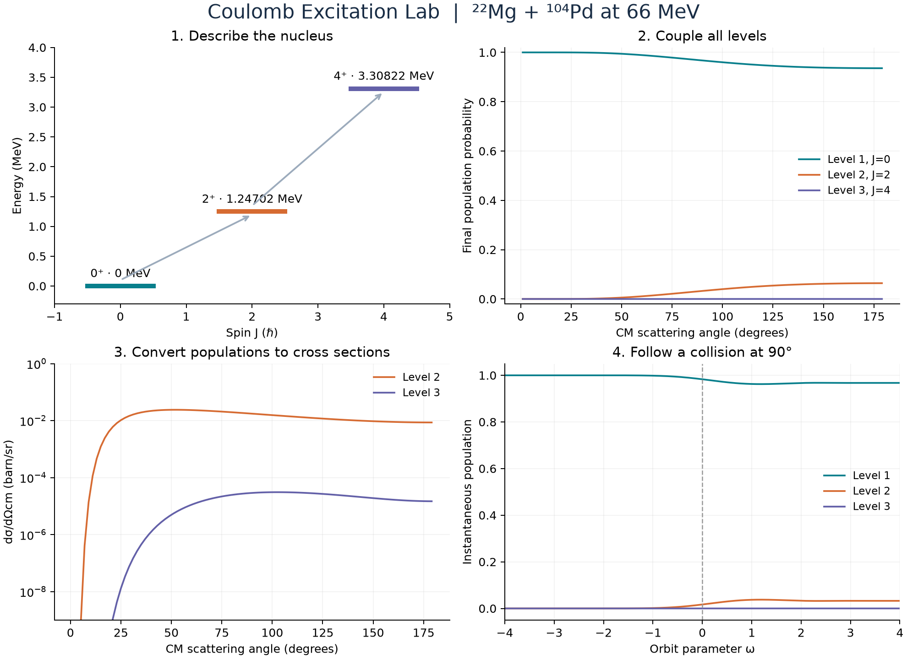

# Coulomb Excitation Lab

An educational Python application with a Streamlit interface for semiclassical Coulomb excitation. It evolves coupled complex amplitudes for all magnetic substates, including multi-step excitation, de-excitation, reorientation and electric E1–E4 transitions.

This application is a Python adaptation of [TCLX](https://github.com/jhenderson88/TCLX) and its successor [Cygnus](https://github.com/jhenderson88/Cygnus), both by J. Henderson. Like Cygnus, it is free software under the **GNU General Public License v3** (see [License](#license)). Numerical comparisons are documented below.

## Start the app

### Easiest: a start script

| System | Start script |
|---|---|
| macOS | Double-click `start_mac.command` |
| Windows | Double-click `start_windows.bat` |
| Linux | Run `./start_linux.sh` in a terminal |

Each script finds a suitable Python, then sets up and starts the app:

1. **First start:** it creates a private Python environment in `.venv` and installs the pinned packages. This needs internet and takes a few minutes.
2. **Later starts** take seconds and work offline.
3. The app opens in your browser at **http://localhost:8501**. Keep the terminal window open while you work; stop the app with **Ctrl+C** in that window, or close it.

You need **Python 3.12, 3.13 or 3.14** (with `venv` and `pip`, as in the python.org installers):

- **macOS:** install from [python.org](https://www.python.org/downloads/macos/) or with Homebrew (`brew install python@3.13`).
- **Windows:** install from [python.org](https://www.python.org/downloads/windows/) and tick **Add python.exe to PATH**. The script uses the `py` launcher when it is available.
- **Linux:** use your package manager, e.g. `sudo apt install python3 python3-venv` (Ubuntu 24.04 or newer), `sudo dnf install python3` (Fedora) or `sudo pacman -S python` (Arch). Debian and Ubuntu ship the `venv` module separately; the script detects this and names the package to install (e.g. `python3.12-venv`).

If no suitable Python is found, the script says so and keeps its window open.

**First time only:**

- **macOS** may refuse to open a downloaded `.command` file. Right-click it and choose **Open**, or allow it under **System Settings → Privacy & Security → Open Anyway**. You can also run `bash start_mac.command` in Terminal.
- **Windows SmartScreen** may warn about a downloaded `.bat` file. Choose **More info → Run anyway**.

### Without a start script

From this folder:

```sh
python3 run.py
```

Or from the parent directory: `python3 coulex_streamlit/run.py`. On Windows use `py -3.13 run.py` (or another supported version).

### Options

The scripts and `run.py` accept the same options:

| Option | Effect |
|---|---|
| *(none)* | Start the app |
| `--test` | Run the automated tests |
| `--verify` | Recheck the solver against the archived TCLX comparison; `--full` checks all angles |
| `--server.port 8502` | Start the app on another port |

For example, run `./start_mac.command --test`, `./start_linux.sh --test` or `start_windows.bat --test`. No C++ compiler or separate installation command is needed.

## What is new in this application

### Result exploration and workflow

- Run directly from the workspace; a completed run opens **Results** automatically.
- Results are grouped into **Populations**, **Cross sections**, **Closest approach**, and **Data and downloads**.
- Summary metrics identify peak total excitation on the computed grid, its angle, the minimum surface separation and normalization drift. These diagnostics are not physical error estimates.
- Inspect the actual populations and cross sections at any calculated angle, without interpolation. Log scales make weak populations easier to see; zero values stay unchanged in exports.
- Plot selection and active calculation/result tabs survive English/Greek switches. Plots retain zoom for the same calculation.
- Detector yields persist across ordinary interactions, can be downloaded as CSV, and are marked stale when detector settings change.
- Measurement comparisons show uncertainty coverage, mean absolute residual and optional residuals in uncertainty units. Missing uncertainties are omitted from that view, never filled with invented values.
- A compact layout and mobile summary grid reduce scrolling; physics equations and integration settings are unchanged by this interface update.


[Desktop interface preview](docs/interface.png) · [Greek mobile preview](docs/interface_mobile_el.png)

### Application features

These are additions and implementation improvements in this project, not claims of new physics:

- **Start scripts for macOS, Windows and Linux** (plus a one-command launcher) and a Streamlit frontend with separate calculation and help sections.
- **English and Greek interfaces**, including instructions, upload guidance, validation messages and plot labels. Changing language preserves inputs and results.
- **A Python numerical implementation** using SciPy DOP853, sparse coupling operators and exact SymPy Wigner symbols. No Numerical Recipes routines are used. Probabilities are neither clipped nor renormalized.
- **Complete initial magnetic-substate averaging**, integer and half-integer spins, signed couplings, E1–E4 transitions and consistent projectile/target kinematics.
- **A literature-based polarization mass convention**, using the excited nucleus, with adjustable strength and an on/off switch.
- **Easy entry of other reactions** through a reaction text file, editable nuclear tables or CSV uploads. Own-data modes start empty, with explicit validation and no example fallback.
- **Measurement uploads** for differential cross sections, populations, detected particles and direct gamma coincidences. Features include column mapping, unit selection, optional uncertainties, error bars, residuals and downloadable comparisons.
- **Detector and target calculations** with lab-angle Jacobians, both inverse-kinematics branches, acceptance integrals and energy-loss averaging from a user-supplied stopping table.
- **Interactive educational plots** of levels, transition connections, angular populations, cross sections, trajectories, driving fields, population histories, magnetic substates and closest approach.
- **Six teaching examples:** five based on cited nuclear data and one exactly solvable rotor model.
- **Independent scientific benchmarks and numerical checks:** published perturbation theory and rotor tables, tighter tolerances, longer trajectories and a second integrator.
- **Reproducible CSV/JSON exports, downloadable templates, an upload guide, a classroom lesson and seven Python API examples.**

All application code, examples, documentation, tests and comparison artifacts are contained in this folder.

## First calculation

1. Choose **English** or **Ελληνικά** in the sidebar.
2. Under **1 · Reaction**, select **Built-in example** and a reaction. Its description distinguishes evaluated nuclear data from model assumptions.
3. Check **2 · Beam and angles**, then press **Run calculation**.
4. Explore **Level scheme**, **Results** and **During the collision**. Press **Follow the amplitudes** to inspect the evolution along one orbit.
5. Use **Detector yields** for acceptance-integrated counts, or **Measurements** to compare your data.
6. Open **Help and reference → Verification** for literature benchmarks and convergence checks. **Guide**, **File formats** and **Physics** explain the workflow and assumptions.

The default magnesium scan usually takes seconds; large level schemes and thick-target calculations take longer. The samarium example contains 153 magnetic substates, all retained.

Plots support Plotly's PNG download. Numerical results can be exported as CSV or JSON; JSON records the actual model, sidebar settings, stopping data and depth calculations. The reaction-text download records the input model; use JSON to preserve sidebar overrides and all run settings.



## Upload another experiment

Choose **My own reaction file** for a `.txt`/`.dat` input or **My own tables** for nuclear levels and matrix elements. In **My own tables** you can also press **Load levels from public data** to fetch the adopted levels and spins of a nucleus from the [IAEA Nuclear Data Services](https://nds.iaea.org/relnsd/vcharts/) (ENSDF). The request is made only when you press the button, and it needs internet access; the loaded levels fill the level table for you to edit. Public data give no matrix elements, so couplings must still be entered. Every uploader provides a format description, a blank template and a separately labelled example. Switching reaction sources clears results belonging to the previous source.

The **Measurements** tab accepts **CSV UTF-8, TSV or pasted spreadsheet cells**. Excel users should export CSV; `.xlsx` workbooks are not read directly. Column mapping handles different measurement headers. Comma, semicolon and tab separators are supported; decimal commas require semicolon or tab separation.

| Measurement | Required columns | Optional columns |
|---|---|---|
| Differential cross sections | `angle_deg,level,value` | `uncertainty` |
| CM populations | `angle_deg,level,value` | `uncertainty` |
| Detected particle counts | `angle_min_deg,angle_max_deg,level,value,efficiency` | `uncertainty` |
| Direct gamma coincidences | Particle-count columns plus `branching_fraction,gamma_efficiency` | `uncertainty` |

Angles are degrees; level numbers start at 1. Select the angle frame and units in the UI. Cross sections may be barn/sr, mb/sr or fm²/sr; probabilities and efficiencies are fractions. Uncertainties are one-sigma values in the same units as the observations. Lab angles refer to the scattered projectile.

Counts also require beam rate, live duration, target thickness and azimuth coverage. Predictions integrate each detector bin; point cross sections are calculated at their supplied angles. Use one beam energy and exposure per uploaded run. Measurements are compared with a supplied nuclear model; matrix elements are not automatically fitted.

See **[the upload guide](docs/UPLOADS.md)** for full schemas, examples, corrections and limitations. Measurement-template numbers and the bundled stopping table are **synthetic**, not experimental data.

## Reaction input and units

A reaction text file contains:

| Lines | Content |
|---|---|
| 1 | Title |
| 2 | Number of levels N |
| 3–4 | Projectile `Z A`, then target `Z A` |
| 5 | Total beam energy in MeV, not MeV/u |
| 6 | Minimum CM angle, maximum, step in degrees |
| Next N | `index spin energy_MeV parity K` |
| Remaining | `initial final reduced_matrix_element electric_lambda` |

The ground state is level 1 at zero energy. Spins may be integer or half-integer; parity is `1` or `-1`. Reduced elements are signed `<initial || Eλ || final>` in **e b^(λ/2)** (E2: e b), not B(Eλ). Enter each coupling once; its reverse is generated with the Hermitian phase. `K` is retained as metadata. Blank lines and `#` or `//` comments are accepted. Choose the excited nucleus in the sidebar.

CSV nuclear tables use `level,spin,energy_mev,parity` (optional `k`) and `initial,final,value,lambda`. Templates and filled examples are provided in the UI. Invalid nuclei, closed channels, forbidden spin/parity couplings, duplicate elements and nonfinite values produce explicit errors.

## Six built-in examples

| Reaction | Purpose | Input provenance |
|---|---|---|
| 22Mg + 104Pd, 66 MeV | Light radioactive beam with an uncertain B(E2) | Evaluated energies/B(E2); rigid-rotor 2+ → 4+ element |
| 58Ni + 208Pb, 220 MeV | Weak E2 coupling and reorientation | Evaluated B(E2), energies and Q(2+) |
| 152Sm + 58Ni, 500 MeV | Multiple excitation and inverse kinematics | Evaluated energies/B(E2); rigid-rotor band elements |
| 16O + 238U, 66 MeV | Excitation of a deformed target | Evaluated energies/B(E2); rigid-rotor band elements |
| 16O + 208Pb, 60 MeV | E3 and E2 target excitation | Evaluated energies, strengths and quadrupole moments |
| Teaching: sudden rotor | Exactly solvable degenerate band | Alder–Winther Table 5 at q = 2 |

The evaluated B(E2) inputs come from [Pritychenko et al. (2016), Table 3](https://arxiv.org/abs/1312.5975); energies and moments also use the cited ENSDF evaluations. Each example's sources and assumptions are listed in `coulex/examples.py`, exported text comments and the Verification tab. Higher rotational-band elements are **model values**, not measured inputs. A small population in the highest included level is only a diagnostic: enlarge the scheme to test truncation.

All example inputs were written for this project from the cited sources. The example beam energies are teaching choices, not a claim to reproduce specific experiments.

## Scientific verification and accuracy

The independent checks in `coulex/literature.py` use CODATA 2018 constants, independently evaluated orbital integrals and printed reference tables. They exercise the same solver used in the UI:

| Check | Scientific reference |
|---|---|
| Elastic Rutherford cross section | Rutherford scattering with CODATA constants |
| Weak-coupling E1–E4 excitation, several angles, nonzero adiabaticity | [Alder et al., Rev. Mod. Phys. 28, 432 (1956)](https://doi.org/10.1103/RevModPhys.28.432) |
| Exact two-state sudden limit | [Alder & Winther (1960), §4](https://gymarkiv.sdu.dk/MFM/kdvs/mfm%2030-39/mfm-32-8.pdf) |
| Rigid-rotor amplitudes and multistep populations | [Alder & Winther (1960), Tables 4 and 5](https://gymarkiv.sdu.dk/MFM/kdvs/mfm%2030-39/mfm-32-8.pdf) |
| Projectile/target polarization mass convention | [Orce (2016), Eq. (4) and footnote 1](https://arxiv.org/abs/1510.04087) |

The 12 solver benchmarks include weak couplings and nonperturbative rotor dynamics. Rounded physical constants produce differences of order 10⁻⁵ from independently computed references; printed rotor probabilities are compared at their 10⁻⁴ table precision. Polarization formula tests separately check both choices of excited nucleus. The empirical strength defaults to `d = 0.005 MeV⁻¹`; it is adjustable because it is a model assumption, not a universal measured constant.

Default ODE controls are `rtol=1e-9`, `atol=1e-12`. Check tolerances, finite orbit range, angular sampling, target-depth quadrature and level-space truncation separately. Probability conservation alone is insufficient. These tests verify numerical implementations and specified theoretical limits; they do not establish experimental accuracy for arbitrary uploaded reactions.

### Comparison with TCLX

The [comparison report](validation/results/REPORT.md) cites [TCLX](https://github.com/jhenderson88/TCLX) and records both TCLX example inputs at every integer CM angle from 1° to 180°: 360 collisions and 2,520 level populations. Maximum absolute probability difference is **6.3 × 10⁻⁷**, with matched polarization settings (`polarization_convention="reference"`). The application's default uses the literature mass convention (`standard`), so its polarized results differ from this comparison. The reference execution uses a tested minimal ROOT adapter, not a complete ROOT/GSL installation.

Run the tests:

```sh
python3 run.py --test
```

Recheck the Python solver against the saved comparison data, including convergence checks and a new plot:

```sh
python3 run.py --verify --full
```

No C++, ROOT or compiler is required. The original source and build tools have been removed. TCLX has no licence, so its two input files are not distributed either: download them into `validation/tclx_inputs/` as described in [its README](validation/tclx_inputs/README.md). Without them, verification stops with these instructions and the tests that need them are skipped; everything else, including the literature benchmarks, runs without them. Verification checks the archived data and input hashes, then writes its new report to `validation/current/`; the historical evidence in `validation/results/` remains unchanged. Without `--full`, it checks ten representative angles. It does not regenerate C++ reference outputs. See [validation/README.md](validation/README.md) for details.

## Research tools and validation

The joint-fit results now include interactive **observed-versus-fitted** and **likelihood-residual** plots for each dataset, with shared normalization applied and labelled parameter correlations. The [multilevel coverage figure](docs/multilevel_coverage.png) shows the recorded interval frequencies and parameter pulls; it helps assess the limits of local-covariance intervals.

For the research qualification evidence and outstanding release gates, see [RESEARCH_QUALIFICATION.md](docs/RESEARCH_QUALIFICATION.md). Run `python run.py --qualify` to reproduce the published invariant benchmark, independent finite GOSIA point comparisons, a geometric spherical-harmonic E1/E4 solver, angular algebra checks and the scoped linear/nonlinear coverage experiments. The generated report explicitly records that research qualification remains incomplete.

**New in this branch:** laboratory gamma detector folding (rotation, Doppler aberration, intrinsic response meshes and energy calibration), shared projectile/target normalization with named nuclear models, and independent geometric E1/E4 checks. Downloadable synthetic examples and a [laboratory response plot](docs/lab_gamma_response.png) explain these additions. Joint-fit count inputs can select projectile, recoil or either-particle event acceptance with a lab annulus and energy threshold. Profiles support a single parameter and show objective curves. The Poisson objective is checked against high-precision arithmetic. These additions and their limits are described in the research guide.

The **Research** tab adds sensitivity scans and experimental-design information, correlated input uncertainty bands, 0+ quadrupole shape invariants, joint multi-experiment fitting, gamma feeding and pure-electric angular correlations, and E3/polarization/model-space comparisons. It includes English/Greek controls, CSV decay/covariance uploads, portable JSON fit configurations and downloadable results tied to their inputs.

Start with the [research guide](docs/RESEARCH.md), its equations and stated physical scope. The [synthetic examples](examples/research/) include two-energy fit data, a covariance matrix, a decay network, an opposite-parity model and a [standalone sensitivity plot](examples/research/sensitivity.png). These fixtures are teaching models, not experimental measurements. Research extensions have analytical and synthetic tests; fitting and gamma response are not claimed to be validated replacements for a full experimental analysis package.

These features extend the same Coulomb-excitation calculation: sensitivity asks what an experiment can constrain, uncertainty propagation tests input assumptions, fitting extracts matrix elements, invariants interpret their structure, and gamma networks connect excitation to photon observables. They are appropriate for university exercises and exploratory studies within the stated physics domain.

| Feature | Checks performed | Remaining limits |
|---|---|---|
| Sensitivity and design | Finite-difference step comparison; normalization-degenerate information test | Local derivatives and an assumed observation-error model do not prove unique parameter determination |
| Uncertainty bands | Zero-covariance limit; covariance validation; reproducible ensemble/UI checks | Assumed input distributions; no uncertainty-coverage validation or bound on omitted physics |
| 0+ shape invariants | Prolate/oblate rotor limits; basis-phase invariance; missing-element reporting | Finite E2 network; effective beta/gamma interpretation; no full shape distribution |
| Joint fitting | Synthetic multi-energy and shared projectile/target recovery; normalization/lifetime constraints; profile test; Gaussian covariance and Poisson residual checks | No published raw-data fit benchmark, general nonlinear confidence-interval coverage or exhaustive minimum search |
| Gamma feeding and angular response | Branch/conversion bookkeeping; analytic photon patterns; complex-density comparison; laboratory rotation/boost and full-sphere tests; full-sphere fed-yield limit | Pure electric transitions; calibrated geometry required; no mixed multipoles, arbitrary particle masks or decay-flight displacement |
| Octupole/model comparisons | Explicit solver recalculation for altered E3, reorientation, polarization and retained levels | Alternative input models are not a unique inference of permanent octupole shape |

**Validation status:** current and historical test counts and logs are recorded in [QA.md](validation/QA.md). An independent GOSIA point comparison and published invariant benchmark now supplement the synthetic tests. The new inference and gamma extensions have not undergone independent expert review or end-to-end validation against a published experimental analysis. The archived excitation-code comparison does not validate these new extensions. See [QA.md](validation/QA.md) and [RESEARCH.md](docs/RESEARCH.md) for the evidence and assumptions.

## Energy loss, yields and scope

Upload validated stopping data for your ion and target as `energy_mev,stopping_mev_per_mg_cm2`. The calculation integrates `dE/dx = −S(E)` with shape-preserving interpolation and rejects extrapolation. Depth quadrature averages each energy's cross section and detector acceptance. Increase its order to test convergence. Stopping-table uncertainty and straggling are not determined by numerical tolerance; straggling is not modeled.

Detector counts include the actual target mass number, areal density, incident particles, solid angle and efficiency. Direct gamma coincidences additionally use supplied photon branching fractions and absolute gamma efficiency. The Research tab supports explicit decay feeding, supplied conversion coefficients, rest-frame angular correlations and optional laboratory response. The laboratory model uses intrinsic directional efficiencies; absolute whole-array gamma efficiency must not be multiplied in again. Conversion coefficients are supplied, not calculated; aligned conversion feeding needs electron-transfer information unless rotational symmetry fixes the daughter density.

This is a nonrelativistic, semiclassical electromagnetic model for excitation of one collision partner at a time. Magnetic transitions, nuclear-force coupling and mutual excitation are not included. Parameter fitting is available in the Research tab with the assumptions documented in the research guide. The 5 fm surface-separation line is a guideline, not a proof that nuclear interactions can be ignored.

Read [NUMERICS.md](docs/NUMERICS.md) for equations and error controls, [LESSON.md](docs/LESSON.md) for classroom exercises and [THIRD_PARTY_NOTICES.md](THIRD_PARTY_NOTICES.md) for attribution.

## Code map and Python use

| Location | Role |
|---|---|
| `start_mac.command`, `start_windows.bat`, `start_linux.sh` | Start scripts: find Python, then call `run.py` |
| `run.py`, `app.py` | Environment setup, launch, interface and exports |
| `coulex/model.py`, `solver.py` | Validated reactions and coupled-amplitude integration |
| `coulex/observables.py`, `stopping.py`, `workflow.py` | Cross sections, detectors, energy loss and scans |
| `coulex/imports.py`, `measurements.py` | Nuclear/measurement imports and prediction comparisons |
| `coulex/*_ui.py`, `formats.py`, `plots.py` | Input workflows, help and figures |
| `coulex/i18n*.py` | English/Greek text |
| `coulex/examples.py`, `literature.py` | Example provenance and independent scientific benchmarks |
| `coulex/research.py`, `research_io.py`, `research_ui.py`, `joint_model.py` | Sensitivity, ensembles, shared normalization and named-model inference/UI |
| `coulex/lab_gamma.py`, `gamma_yields.py` | Laboratory photon rotation/boost, calibrated meshes and fed particle–gamma counts |
| `coulex/shapes.py`, `decay.py`, `acceptance.py` | 0+ invariants, decay/photon response and recoil-aware particle acceptance |
| `docs/RESEARCH.md`, `examples/research/` | Scientific scope, upload schemas, synthetic fixtures and plots |
| `examples/library_examples.py` | Seven worked Python API examples |
| `tests/`, `validation/` | Automated tests and reproducible comparison artifacts |

From this folder, with the installed environment:

```python
from pathlib import Path
from coulex import CoupledChannels, parse_input

reaction = parse_input(Path("examples/22Mg_104Pd_literature.txt").read_text())
result = CoupledChannels(reaction).solve(90.0, history_points=401)
print(result.probabilities, result.norm_error)
```

## License

Copyright (C) 2026 Stylianos Nikas.

This program is free software: you can redistribute it and/or modify it under the terms of the GNU General Public License as published by the Free Software Foundation, version 3. It is distributed in the hope that it will be useful, but **without any warranty**; without even the implied warranty of merchantability or fitness for a particular purpose. See [LICENSE](LICENSE) for the full text.

**Origin and modifications.** This is a modified work: a Python reimplementation, written in 2026, of the semiclassical Coulomb-excitation calculation in [TCLX](https://github.com/jhenderson88/TCLX) and its successor [Cygnus](https://github.com/jhenderson88/Cygnus) by J. Henderson, which build on the Fortran CLX code of H. Ower and J. Gerl and the GOSIA formalism. The collision functions and the integration of the excitation amplitudes over the orbit follow that code, which Cygnus publishes under the GNU GPL v3. Changes include a new Python/SciPy solver, the English/Greek Streamlit interface, measurement comparisons, detector and energy-loss calculations, literature benchmarks, examples, documentation and tests.

TCLX itself carries no licence. Its source is not included, and its two example input files are not distributed; [validation/tclx_inputs/README.md](validation/tclx_inputs/README.md) explains how to obtain them. Third-party libraries and their licences are listed in [THIRD_PARTY_NOTICES.md](THIRD_PARTY_NOTICES.md).


## Maintainer and reviews

[@nikas1s](https://github.com/nikas1s) maintains this repository and owns all code. Pull requests to `main` require their code-owner approval; a second review is welcome but optional. The maintainer retains the administrator override for their own PRs because GitHub does not allow self-approval. See [MAINTAINERS.md](MAINTAINERS.md) and the versioned [protection settings](.github/main-protection.json).
