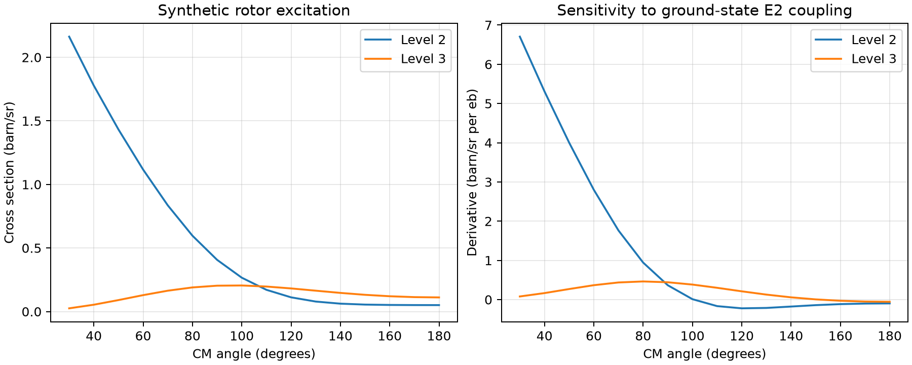

# Research workbench

The **Research** tab adds six workflows to the educational application. They use the current sidebar model and its numerical settings; they do not require running the ordinary results scan first. Expensive calculations run only when **Run research calculation** is pressed. Changing an input hides the corresponding stale output. Results JSON records the nuclear model, solver settings, target assumptions and research configuration.

These are tools for investigating models and testing analyses. Analytical limits and synthetic recovery tests are provided; the extensions have not been validated as a replacement for an established experimental-analysis package on published raw data. In particular, the existing comparison with the cited adaptation source does not validate fitting or gamma response.

## Quick exercises

1. Start with `python run.py`. In **My own reaction file**, upload `examples/research/synthetic_rotor.txt`. Set polarization **off** to match the synthetic observations. These are artificial levels and couplings for a nominal 40Ca + 208Pb reaction, not measured 40Ca structure.
2. In **Sensitivity and design**, select the ground-state transition element and the diagonal 2+ element. Compare 140 and 160 MeV. Inspect the derivatives, step-size differences, heatmap and normalization-profiled information matrix.
3. In **Uncertainty bands**, choose all four E2 elements, upload `rotor_covariance.csv` (no header), and calculate an ensemble. Try increasing the sample count and changing the seed. This file has independent 5% element uncertainties; correlations are illustrative zeros.
4. In **Nuclear shape invariants**, check `cos3gamma ≈ 1`. Change the sign of the diagonal quadrupole elements to obtain the oblate rotor limit. Rephasing a level requires changing *all* incident off-diagonal elements; that operation leaves the invariants unchanged.
5. In **Joint parameter fitting**, upload `synthetic_joint_fit.json`. It combines three angles at each of two energies, normalization nuisance parameters and two starting solutions. Its data are noiseless synthetic predictions with assigned 3% errors. They test recovery, not goodness-of-fit calibration on real experiments.
6. In **Gamma cascades and correlations**, upload `rotor_decay.csv`. Populate the 4+ state and inspect feeding of 2+. Condition on the first photon to explore gamma–gamma correlations.
7. Upload `synthetic_octupole.txt`, then use **Octupole and model comparisons**. Its opposite-parity bands and E3 couplings are a schematic axial-rotor input, not evidence of deformation in a real nucleus. Compare E3 removal, quadrupole signs, polarization and increasing level spaces.

Regenerate the fixtures with `python examples/research/make_examples.py`. Generate a standalone figure with `python examples/research/run_study.py`. From a managed environment, use `.venv/bin/python` instead of `python`.



## Sensitivity and experimental design

Central finite differences evaluate the full coupled-channel cross section at `p±h` and `p±h/2`. The displayed derivative uses `h/2`; the difference between estimates is an empirical step-convergence diagnostic. Compare a range of steps and tighten ODE and orbit settings independently. Derivatives have units of cross section divided by the parameter's units. They can be small near extrema even when a nonlinear model is informative.

Selectable parameters are signed electric matrix elements, total beam energy and the existing E2 polarization strength. Multiple beam energies are explicitly recalculated. Targets can be compared by changing the sidebar reaction; joint-fit experiments also support separate collision nuclei. Surface-separation and nonrelativistic validity checks remain necessary; a large derivative is not a reason to leave the electromagnetic model's domain.

The design panel assumes independent Gaussian cross-section errors `sigma_i = f mu_i`, evaluated at the selected model. With Jacobian `J` and log-normalization derivative `v=mu`, it displays the profiled information

```
F = Jᵀ W J - (Jᵀ W v)(vᵀ W J)/(vᵀ W v + 1/s_norm²).
```

The errors are treated as fixed at the nominal design, not differentiated as a parameter-dependent variance model. This is a local design approximation. Units depend on the selected parameters, so eigenvalues and raw derivative magnitudes are not invariant to rescaling. Check rank, parameter correlations and alternative solutions before interpreting an apparent sensitivity as a unique constraint. The Python `information_matrix` function accepts explicit errors instead of the UI's fractional-error assumption.

## Propagating uncertainty

The nuclear-input ensemble samples a user-specified correlated multivariate Gaussian. Supply a symmetric positive semidefinite covariance CSV without headers, in the exact order of the selected parameters. Diagonal entries are variances, not standard deviations. Without a file, the editable sigma column supplies independent uncertainties. Store physical units consistently with the model: matrix elements in `e b^(lambda/2)`, total beam energy in MeV, polarization coefficient in MeV^-1.

Target thickness and stopping normalization can additionally vary independently as log-normal scales. The supplied uncertainty is `sd(log(scale))`; nominal values are medians. A stopping uncertainty requires an uploaded stopping table. A thickness variation affects depth-averaged cross sections through energy loss; with no stopping it does not change a thin-target differential cross section. Count normalization uncertainty belongs in a count experiment or its normalization nuisance.

The UI exports all input draws and systematic scales, and plots the median and central 95% range. These are **input-distribution quantiles**, not inferred confidence intervals. Sample-count/seed stability is a separate check. A draw that violates the input model fails explicitly rather than being silently discarded. Gaussian ensembles are unsuitable near physical bounds; the present UI does not implement truncated or other bounded priors. Level-space choices and polarization-model alternatives are investigated with the model comparison tool, rather than merged into numerical error bars.

## Quadrupole invariants

The implementation currently supports any included **0+ state**, using all supplied 2+ states of positive parity. Define

```
v_i = <0||E2||2_i>, M_ij = <2_i||E2||2_j>
q2 = sum_i v_i²
q3 = -sqrt(7/10) sum_ij v_i M_ij v_j
c = q3 / q2^(3/2)
gamma_effective = acos(c)/3
beta_effective = 4 pi sqrt(q2) / (3 Z R²), R = 1.2 A^(1/3) fm.
```

The code converts `sqrt(q2)` from eb to e fm² in the beta mapping. q2 is in e²b², q3 in e³b³. This q3 convention includes the `-sqrt(7/10)` factor; compare definitions before importing an external q3. The sharp-surface small-deformation beta mapping and the effective gamma moment ratio do not reconstruct a shape distribution or establish a unique rigid shape. Higher-order invariants and deformation fluctuations are not calculated.

Missing matrix elements in the supplied network are listed and treated as zero for the finite sum. Missing states cannot be discovered from the input itself. Enlarge the state space and examine q2 contributions; a small final population is not proof that a state's invariant contribution is negligible. `|c|>1` is reported directly, with missing gamma, not clipped to a physical-looking angle. E2 covariance ensembles preserve correlations and report the count of valid gamma samples.

Primary foundations: [Kumar (1972)](https://doi.org/10.1103/PhysRevLett.28.249), [Cline (1986)](https://doi.org/10.1146/annurev.ns.36.120186.003343). A modern experimental application is [70Ge, Kowalewski et al. (2025)](https://doi.org/10.1103/cmks-jst1).

## Joint inference and upload schema

Download the JSON template in the UI. **Its observations are placeholders**: replace them before fitting. Parameter `index`, data `level`/`lower`, decay `upper`/`lower`, `photon_transition` and profile `parameter` are **one-based** in JSON. Python APIs use zero-based parameter/transition/state indices; measurement DataFrame level columns remain one-based.

```json
{
  "parameters": [{"kind": "element", "index": 1}],
  "bounds": [[0.1], [2.0]],
  "starts": [[0.5], [1.0]],
  "max_nfev": 100,
  "experiments": [{
    "kind": "cross_section", "frame": "CM", "energy_lab": 160,
    "likelihood": "gaussian", "normalization_sigma": 0.03,
    "data": [{"angle_deg": 90, "level": 2, "value": 0.01, "uncertainty": 0.001}]
  }]
}
```

The template's numerical values above illustrate a format, not an experimental result. Observations must use canonical units: cross sections in barn/sr, probabilities in [0,1], counts as counts. Existing point/bin columns are documented in [UPLOADS.md](UPLOADS.md). Measurement CSV files can be read into DataFrames and embedded as JSON `data` records. JSON keeps the distinct exposure and normalization metadata attached to each dataset.

Each experiment accepts:

- `kind`: `cross_section`, `probability`, `particle_counts`, `gamma_counts` (the existing direct-photon model), or `cascade_counts` (population feeding).
- `frame`: `CM` or `Lab`. Both inverse-kinematic branches and finite bin acceptance use the existing measurement predictor.
- `energy_lab`: total projectile MeV. `reaction_overrides` can set `projectile_z`, `projectile_a`, `target_z`, `target_a`. The fitted structure still belongs to the same excited nucleus; use these overrides to change the collision partner, not replace the excited nucleus with a different isotope while retaining its matrix elements.
- `exposure`: object with `beam_per_second`, `days`, `thickness` (mg/cm²), `azimuth_fraction`.
- `stopping`: object with arrays `energy` (MeV) and `stopping` (MeV per mg/cm²). It must cover the full depth trajectory.
- `order`, `angular_step`: depth quadrature and detector angular spacing. Check convergence of integrated yields separately.
- `likelihood`: `gaussian` with positive per-row `uncertainty`, or full positive-definite `covariance` in the same observation order. `poisson` requires **raw nonnegative integer counts**, without background subtraction; zero counts are supported. Unknown uncertainties are never invented.
- `normalization_sigma`: optional standard deviation of the dataset's log-normalization nuisance. The scale is `exp(eta)`, with penalty `(eta/sigma)²`. It can represent a shared efficiency/exposure calibration error. A Gaussian data covariance handles correlated observation errors. Do not count the same systematic twice.

External Gaussian constraints can be separate experiments:

- `strength`: records `level,lower,lam,value,uncertainty`, where value is downward or upward B(Eλ) according to the specified initial `level`, in e²b^λ.
- `quadrupole`: `level,value,uncertainty`, signed spectroscopic Q in eb.
- `lifetime_ps`: `level,value,uncertainty`, **mean lifetime**, not half-life. It sums outgoing electric radiative rates from the supplied matrix elements and optional conversion coefficients. Missing branches or magnetic strengths invalidate interpreting this as a complete physical lifetime.

For cascade counts, supply `transitions` records `upper,lower,branch,alpha,multipolarity`, and select `photon_transition`. Rows use particle-count columns plus `gamma_efficiency`, interpreted as an isotropic absolute photon efficiency. Each initially populated level is integrated using its own excitation-energy-dependent particle kinematics, then weighted by the network's emitted-photon probability. This fit mode does not fold the aligned angular response from the separate gamma explorer; using an isotropic efficiency for anisotropic detectors requires experimental justification.

The objective is Gaussian chi-square plus Poisson deviance plus nuisance penalties. Fits use bounded SciPy least squares, multiple supplied starts and direct solver predictions. Local covariance is `(JᵀJ)^-1` without reduced-chi-square rescaling; it is withheld for failed, rank-deficient, severely ill-conditioned or boundary solutions. This is an approximation, not a coverage guarantee. Positive and negative starts help expose sign ambiguities, but cannot prove all minima have been found.

For two or more fitted physical parameters, optional `"profile": {"parameter": 1, "grid": [...]}` fixes one parameter and refits the others plus nuisances. Profiles export raw objective values and convergence flags. Subtract the global minimum for a delta-objective plot; asymptotic thresholds require regularity and adequate statistics. The current profile implementation performs one remaining-parameter start per grid point; repeat with alternative starts where multiple minima occur. Bayesian sampling is not implemented.

The normalization and correlation treatment is motivated by [Zielińska et al. (2016)](https://arxiv.org/abs/1506.04633). No GOSIA fitting source code is incorporated.

## Decay networks, rates and angular response

Upload CSV columns `upper,lower,branch,alpha,multipolarity` or edit the network. Branch fractions are **total** probabilities including conversion; alpha is the internal-conversion electron/photon ratio from an external evaluation. Every edge must decrease energy and satisfy electric angular-momentum/parity selection; outgoing branches cannot exceed one. Missing probability remains an explicit sink. For populations, transfer to the daughter is `p_upper * branch`; emitted photons are `p_upper * branch/(1+alpha)`. Initial populations and feeding are both counted.

Default branch suggestions come from radiative rates of the supplied electric matrix elements, with alpha=0. They are model-derived, not evaluated branching data. Lifetimes use the standard multipole formula

```
lambda_gamma = [8 pi (L+1)/(L ((2L+1)!!)^2)]
               (E_gamma/(hbar c))^(2L+1) [e²/(4pi epsilon0 hbar)] B(EL).
```

After conversion to e²fm^(2L), E2 gives approximately `1.22519e9 E_gamma^5 B(E2)` per second with the constants in the module. Total rates multiply by `(1+alpha)`. Missing E0, magnetic, particle and other decay modes are not synthesized. Equal-energy transitions do not have positive photon energy.

The collision solver now retains the density matrix for each final spin: `rho_J=A_J A_J†/(2J_ground+1)`. Its trace equals the existing level population. Pure-electric emission operators are built from exact Clebsch–Gordan coefficients, and photon helicities ±1 are summed. The response uses Wigner rotations with normalization `(2L+1)/(8pi)`; integration over 4pi reproduces the parent population.

The angular explorer shows photon density at phi=0 and integrates a full-azimuth polar annulus with analytic azimuth integration and Gauss–Legendre polar quadrature. Angles are in the **emitter rest frame relative to the solver orbit quantization axes**, with the same fixed scattering plane. They are not beam-axis laboratory detector coordinates. A production detector model must rotate these axes for each scattered-particle trajectory, average particle azimuth/acceptance, and handle boosts, Doppler response and finite flight distances. Arbitrary phi sectors and efficiency are supported by the Python `fold_detector` API.

Unobserved pure-photon feeding transfers density matrices through the cascade. Conditioning on the first photon propagates its daughter density to show subsequent gamma–gamma correlations; displayed conditional distributions are per selected first photon, whereas the photon-yield table remains the ungated yield per collision. Alpha>0 population yields are supported. Aligned feeding with internal conversion is explicitly rejected because electron transfer tensors cannot be replaced by photon tensors. Mixed multipoles, magnetic emission, hyperfine deorientation and finite lifetime detector-displacement effects are not implemented.

The general density-matrix approach is discussed by [Chalil et al. (2021)](https://arxiv.org/abs/2110.00619). The implementation here uses explicit finite spin operators, tested against analytical limits, rather than copying a cascade simulation.

## Octupole collectivity and model dependence

Scenario rows scale E3 elements, diagonal E2 elements and polarization strength, or truncate the retained level prefix. Calculations preserve all remaining signed couplings and rerun the solver. Use the existing 208Pb literature example for a measured E3 strength, and the clearly synthetic opposite-parity example for multistep exercises. To study convergence, construct successively larger physically motivated spaces; truncating a prefix is useful only when the input level order has that meaning.

The app does not infer a permanent pear shape from one B(E3). Testing vibrational and octupole-rotor descriptions requires complete, justified alternative level/coupling networks and experimental constraints. See [Butler et al. (2020), radium octupole deformation](https://doi.org/10.1103/PhysRevLett.124.042503). The adjustable effective polarization strength remains a model parameter; changing it and explicitly including E1 strength may double-count dipole response. [Orce (2016)](https://arxiv.org/abs/1510.04087) discusses isotope-dependent polarization corrections.

## Validation

`tests/test_research.py` checks axial prolate/oblate rotor invariant limits and phase invariance; cascade feeding and conversion bookkeeping; normalized E1 and E2 angular patterns; the 0→1→0 angular correlation; full-solid-angle response of coherent E2 and E4 spin states (including an E4 azimuth-aliasing regression); density positivity and trace; electric decay rates; finite-difference convergence; zero-covariance propagation; Gaussian multi-energy synthetic parameter recovery with normalization and lifetime constraints; Poisson zero-count behavior; correlated Gaussian residuals; normalization-degenerate information; JSON import and fed count prediction.

`tests/test_research_ui.py` exercises calculations, stale-result protection, task selection, Greek switching and ensemble results. Existing physics and archived-reference tests remain applicable to the excitation solver. Finite angular/depth grids, finite orbit range, derivative steps, ensemble Monte Carlo error and omitted physical model space are separate convergence questions.
