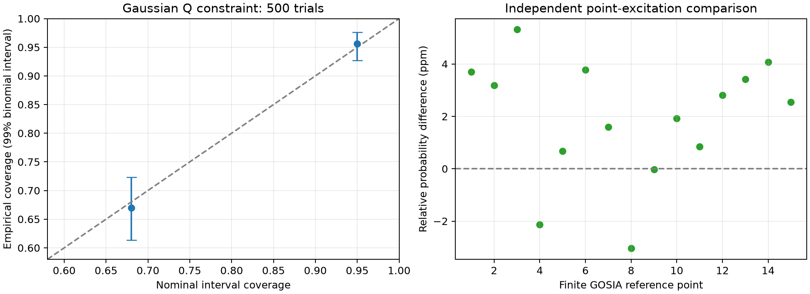

# Research qualification record

**Current status: qualification incomplete.** The application has scoped numerical evidence, rather than a blanket certification for research. A scientific code can be validated for specified observables and conditions; neither automated tests nor a literature citation establishes correctness for every measurement.

The first qualification target is the existing nonrelativistic, semiclassical, pure-electromagnetic model. Its domain excludes magnetic excitation, mutual excitation, nuclear-force coupling and relativistic trajectories. Gamma tools have additional pure-electric/rest-frame restrictions. Physical adequacy must be justified for the particular reaction, including separation, omitted levels and systematic effects.

## Reproduce the current evidence

```sh
python run.py --qualify
```

The offline command uses published numerical fixtures and archived numerical outputs. It requires no Fortran compiler, download, or additional dependencies. It records the Python/package versions, source and fixture hashes, individual results and remaining gates in `validation/research_qualification/latest.json`. Exit code zero means the listed computational checks pass; it does **not** mean all research qualification gates have been met. `research_qualified` remains false until the outstanding work and review are resolved.

### Published shape-invariant check

The five ground-state-network E2 elements in Tables 1–2 of [Gray et al., 106Cd (2022)](https://arxiv.org/abs/2209.06298) give q2 = 0.442521 e²b², q3 = 0.0115213 e³b³ and effective gamma = 29.2523°. They agree with the printed invariant results within input/output rounding. The fixture records its source, precision and restricted purpose. This verifies the invariant calculation, not an experimental-yield fit or the paper's full covariance analysis.

### Independent excitation-code comparison

The official [GOSIA reference distribution](https://www.pas.rochester.edu/~cline/Research/GOSIA.htm) was compiled separately in the ignored local cache. The recorded comparison uses our generated synthetic inputs, polarization off and three lab angles per model. Fifteen finite reference points cover target E2/E3 excitation, E2 multistep excitation with diagonal reorientation, and an unpolarized half-integer ground state. They agree within the preselected criterion `|delta P| <= 1e-10 + 3e-4 |P_ref|`; observed relative differences are below 6e-6.

The E1 and E4 isolated reference runs produced nonfinite populations. Their input/output records remain in the evidence, but they do not qualify these multipoles. This may reflect reference-code assumptions, numerical behavior or setup constraints; the cause has not been resolved. No tolerance was widened to pass them.

The official integrated speed/accuracy benchmark was also inspected. It contains magnetic matrix elements and gamma detector corrections, so its outputs are not directly comparable to our present pure-electric/rest-frame implementation. It is not counted as a passed benchmark.

To regenerate the optional point comparison, download the official `gosia.f` into `.cache/research-qualification/` and compile it there:

```sh
gfortran -std=legacy -O0 -o .cache/research-qualification/gosia .cache/research-qualification/gosia.f
python validation/gosia_points.py --binary .cache/research-qualification/gosia --source .cache/research-qualification/gosia.f
```

The source URL, source/executable hashes, compiler version, command, generated inputs and numerical comparison are recorded. The external Fortran code is not redistributed or required to run the app. The older code generated compiler warnings; the comparison does not certify that reference implementation itself.

### Independent angular algebra

Wigner rotations are compared against matrix exponentials of the angular-momentum generator, using an implementation independent of the production finite factorial sum. Sixty allowed integer/half-integer spin and E1–E4 combinations also test trace transfer, full-solid-angle normalization and isotropy. The largest rotation discrepancy was about 1.1e-15. These are algebra/normalization checks; they do not validate beam-to-detector coordinate transformations, mixed multipoles, conversion-electron transfer or a complete experimental response model.

### Statistical coverage experiment

Five hundred seeded Gaussian quadrupole-moment pseudoexperiments were fitted through the actual inference entry point. The independent analytical estimator and its variance agree with the numerical outputs. Observed coverages were 67.0% for nominal 68% intervals and 95.6% for nominal 95% intervals; each nominal value lies in the corresponding exact 99% binomial interval. No fits failed.

This checks an interior, linear Gaussian external-Q constraint. It does not establish coverage for nonlinear coupled-channel fits, low-count Poisson observations, boundary solutions, correlated normalization calibration, alternative signs or omitted physical effects. More pseudoexperiments reduce Monte Carlo uncertainty but do not expand the model cases being tested.

## Gates required before a scoped research release

| Gate | Acceptance evidence | Status |
|---|---|---|
| Excitation solver | Independent point references over projectile/target, multipoles, spin character, energy and angular regimes; convergence/error budget | Partial: finite target E2/E3 cases pass; broader domain open |
| Derivatives and integration | Several difference steps, orbit/ODE settings and angular/depth quadratures, with changes below the intended measurement error budget | Basic tests exist; representative experimental cases still required |
| Experimental yields | Published or supplied raw yields, complete nuclear input network, exposure, stopping and detector/response information; matched corrections and conventions | Open |
| Parameter inference | Alternative starts/signs, independent optimizer comparison, nuisance calibrations and profile checks on representative nonlinear fits | Synthetic recovery exists; comprehensive qualification open |
| Interval coverage | Repeated nonlinear Gaussian/Poisson fits with calibration uncertainty and bounds; failures retained; predeclared nominal coverage tests | Linear-Gaussian reference passes; nonlinear/count cases open |
| Gamma response | Matched laboratory coordinate rotations and acceptances; feeding/branching/ICC checks; mixed-multipole support where required by the chosen experiment | Rest-frame pure-electric module only |
| Model adequacy | Separation, relativity, channel/level completeness, omitted couplings and model-systematic study for each declared reaction class | Experiment dependent; open |
| Independent review | Nuclear-physics reviewer reproduces the versioned benchmarks, checks conventions, signs, units and claim scope | Open; cannot be supplied by self-testing |
| Reproducibility | Tagged revision, package lock, source/fixture hashes, automated cross-platform results | Local records present; CI workflow added but remote runs not yet performed |

Before calling a release research validated, choose the measurement class and agreed accuracy budget, close the applicable gates, and retain a reviewer-approved report tied to a version. A finite benchmark set supports a bounded claim; it cannot prove correctness for all possible inputs.

## Audit fixes

The qualification work found and fixed covariance symmetry checks that depended on an absolute tolerance and could accept a strongly asymmetric matrix expressed in tiny units. Symmetry is now checked without an absolute unit scale, and positive semidefiniteness is tested in dimensionless correlation coordinates, including mixed-unit and zero-variance cases. Fit covariance is constructed with an SVD rather than inversion of the squared-condition normal matrix. A missing electric decay network now gives a scientific input error for a lifetime constraint rather than a DataFrame attribute error. Each fix has regression coverage or existing inference recovery checks.

## Experimental target selected from the literature

The first target is the 96Sr + 120Sn measurement of [Clément et al. (2016)](https://doi.org/10.1103/PhysRevC.94.054326). The source-attributed manifest and Table I subset are in `validation/research_qualification/experiments/sr96_sn120/`. Missing response and analysis inputs are explicitly marked. The qualification report audits their availability, without claiming that an experimental fit has been reproduced. All three requested use cases—planning, shape studies and experimental gamma analysis—are tracked separately in the report.


