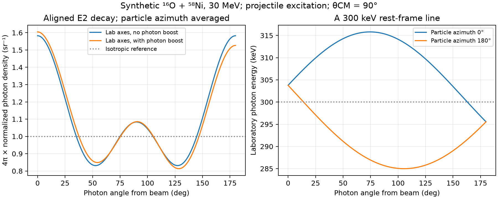

# Research qualification record

**Current status: computational checks pass in the recorded cases; research qualification remains incomplete.** A version can be validated for specified observables, physical conditions and error budgets. Automated tests and bibliography alone do not establish correctness for every measurement. All three requested uses—planning, shape studies and experimental gamma-yield analysis—are tracked in the report.

The model is nonrelativistic, semiclassical and electromagnetic, with one collision partner excited at a time. It excludes magnetic excitation, nuclear-force coupling, relativistic trajectories and product-space mutual excitation. Separate projectile and target models may share a normalization scale. The laboratory gamma model supports pure-electric feeding and supplied intrinsic detector response. Its additional restrictions are in [RESEARCH.md](RESEARCH.md).

## Reproduce the evidence

```sh
python run.py --test
python run.py --qualify
python run.py --qualify --extended
```

The first qualification command runs the published invariant check, archived GOSIA comparisons, a new independent geometric E1/E4 calculation, angular algebra, and scoped linear/nonlinear statistical checks. It requires no compiler or reference-code download. The extended command also performs 100 multilevel coupled-channel pseudoexperiment fits with normalization calibration and two starts per fit; allow additional time. The separate full detector convergence study is:

```sh
.venv/bin/python validation/lab_response_convergence.py
```

Use `.venv/Scripts/python.exe` on Windows. The report records package/platform versions, source and fixture hashes, individual checks and remaining gates in `validation/research_qualification/latest.json`. Exit zero means the computational checks executed by that command pass. It does **not** grant research qualification. Archived multilevel and detector-convergence evidence is identified separately from checks rerun by that invocation.

## Published shape-invariant check

The five E2 elements in Tables 1–2 of [Gray et al., 106Cd (2022)](https://arxiv.org/abs/2209.06298) give q2 = 0.442521 e²b², q3 = 0.0115213 e³b³ and effective gamma = 29.2523°. These agree with the printed invariant results within rounding. `cd106.json` records the source and precision. This verifies the invariant calculation, not the paper's full covariance analysis or experimental-yield fit.

## Independent excitation calculations

The official [March 2008 GOSIA distribution](https://www.pas.rochester.edu/~cline/Research/GOSIA.htm), compiled separately in an ignored cache, supplies 27 passing points across target E2/E3, multistep/reorientation, half-integer ground spin, coupled E2/E4, projectile E2 and target polarization. The preselected criterion is `|delta P| <= 1e-10 + 3e-4 |P_ref|`; these differences are below 6 ppm. Generated inputs/results are in `gosia_points/` and `gosia_expanded/`.

The original isolated E1/E4 runs were nonfinite. Their failed records and the first diagnostic study remain intact as historical evidence. The later investigation resolves the **specific benchmark limitations**, without widening tolerances:

- A bounds-checked build confirms that legacy E1 accesses orbit entry 366 beyond the 365-element table at `ACC,8.0`. Extending storage alone leaves a mesh error just outside the original relative tolerance.
- The [maintainer version dated 24 February 2026](https://apps.ikp.uni-koeln.de/~warr/gosia/) includes explicit initialization of the startup coefficient that was uninitialized in the inspected legacy path. Its **unmodified isolated E4** runs pass at all three lab angles. The maintainer page itself cautions that its variants have not all been tested.
- A controlled numerical variant of that version extends storage and its guard to 3000 entries and changes orbit spacing from 0.03 to 0.015 and 0.0075. No collision-function or coupling expression is changed. Fine-mesh isolated E1 passes at all three angles; the maximum relative difference is about 52 ppm. These are explicitly **modified numerical-reference runs**, not unmodified-code comparisons.

`gosia_precision/results.json` records source/executable hashes, compiler commands, every replacement, coarse/fine results and the unmodified E1 storage-guard stops. The default replay checks nine outcomes: three unmodified E4, three fine-mesh E1, and three fine-mesh E4. These are six distinct physical points with an additional E4 numerical-variant comparison. Together with the earlier 27, the report contains 36 accepted outcomes; this count does not imply 36 independent physical configurations.

An additional solver, `independent_cc.py`, constructs the Hamiltonian directly from spherical harmonics of the physical Rutherford separation vector and the Wigner–Eckart theorem. It uses CODATA constants and unitary midpoint propagation, without importing production collision polynomials, coupling constants, angular operators or ODE routines. Six isolated E1/E4 cases at CM 45°, 90° and 135° pass probability and **complex spin-density** comparisons, 4000/8000/16000-step refinement, orbit-range and norm checks. The acceptance criterion is `2e-8 + 1e-4 |P|`, with separate step/tail limits. The remaining approximately 55 ppm E4 difference is consistent with historical rounded production constants versus independent physical constants; it is not removed by renormalization. See `geometric-reference.json`.

Optional regeneration of the numerical reference requires a compiler and separately downloaded source:

```sh
gfortran -std=legacy -O0 -o .cache/research-qualification/gosia .cache/research-qualification/gosia.f
python validation/gosia_points.py --binary .cache/research-qualification/gosia --source .cache/research-qualification/gosia.f
python validation/gosia_points.py --suite expanded --binary .cache/research-qualification/gosia --source .cache/research-qualification/gosia.f
python validation/gosia_precision.py --source .cache/research-qualification/gosia-current.f
python validation/geometric_benchmark.py
```

For the last GOSIA command, download `gosia_20110524.13.f` from the maintainer page as `gosia-current.f`. Reference source/executables stay in `.cache` and are not distributed or required by the app. The old integrated speed/accuracy example contains magnetic elements and additional detector physics, so it is not counted as a directly matched benchmark.

## Angular algebra and laboratory photon response

Independent angular-momentum matrix exponentials verify the production finite-sum Wigner rotations. Sixty integer/half-integer E1–E4 cases check trace transfer, isotropy and full-solid-angle normalization. The largest recorded rotation discrepancy is approximately 1.1e-15.

The new laboratory response has checks for proper rotation of incoming/outgoing Rutherford velocities, analytic Lorentz aberration/Doppler factors, isotropic-efficiency limits, boosted full-sphere photon conservation including aligned E4, and the analytic oriented-state formula

```
W(|L,0> → |0,0>; c) = (2L+1)(1-c²)[P'_L(c)]² / [4π L(L+1)].
```

The latter uses independent Legendre derivatives and checks arbitrary detector sectors, both collision partners, coordinate rotation and boosts together. A full-sphere intrinsic-efficiency detector also recovers the population-cascade count limit, including feeding and symmetry-allowed conversion. Tiny density matrices are validated relative to their scale; invalid Hermiticity or positivity cannot hide behind an absolute tolerance.

`lab-response-convergence.json` records simultaneous angular-bin, target-depth, detector-mesh and particle-azimuth refinement for a synthetic nondegenerate fed E2 network with stopping, a gamma sector, energy-dependent intrinsic efficiency, either-particle acceptance and a particle threshold. Its predeclared medium/fine criterion is `1e-8 + 5e-4 |count|`, and a tighter-ODE check uses relative 1e-5. This is one numerical case, not a measured detector uncertainty budget. Mesh calibration, masks, finite-flight response and omitted physics require separate experimental evidence.



## Statistical evidence

- **Linear Gaussian:** 500 seeded external-Q fits agree with the independent estimator and variance. Observed nominal 68%/95% coverage is 67.0%/95.6%, consistent with exact 99% binomial intervals; no failed fits.
- **Nonlinear analytic limit:** the actual coupled-channel ODE is fitted in the sudden degenerate two-state limit on its first monotone branch. One hundred Gaussian trials give 71%/96% coverage. Five hundred ideal Poisson-thinned population trials give 98.4% coverage for transformed exact central 95% limits, consistent with analytic discrete coverage 98.8095%. All failures are retained. Exact transformed limits are a qualification reference, not a general interval algorithm in the UI.
- **Nondegenerate multilevel:** `multilevel-coverage.json` and its log record 100 seeded 0+/2+/4+ E2 fits, four cross sections, an independent Q measurement, a fresh normalization calibration, two physical parameters and the shared scale. Each fit uses two starts and direct ODE predictions. Local Wald coverages for all three parameters are compared with predeclared exact 99% binomial intervals; failed and boundary fits count against the result. This checks one ideal Gaussian configuration, not Poisson multilevel fitting, fitted detector calibration or a general guarantee for local intervals. Run `--extended` to regenerate it.

The count objective is checked against high-precision arithmetic near equal high counts. Single-parameter profiles refit nuisance scales and distinguish impossible zero-mean observations from optimizer failure. Shared normalization priors are counted once; a synthetic simultaneous projectile/target fit recovers planted elements and its free scale. Spectroscopic constraints remain independent of that scale unless explicitly assigned to a group.

Exact central Poisson limits follow [Garwood (1936)](https://doi.org/10.1093/biomet/28.3-4.437). The UI's asymptotic profile thresholds use [Wilks (1938)](https://doi.org/10.1214/aoms/1177732360); they are not exact small-count intervals.

## Experimental target and release gates

The first experimental target remains 96Sr + 120Sn from [Clément et al. (2016)](https://doi.org/10.1103/PhysRevC.94.054326). Seven Table I peak intensities and their reported errors are archived with attribution in `experiments/sr96_sn120/`. They are not efficiency-corrected and are not asserted to be raw Poisson counts. The manifest explicitly lists missing calibrated response, stopping/beam distribution, complete spectroscopic inputs, normalization/covariance and original fit settings. No guessed detector curve is substituted for the experiment's calibration.

A public-input search also inspected the [202Rn/109Ag example](https://github.com/lpgaff/chisqsurface/tree/master/example), which includes M1 structure outside this pure-electric implementation, and [PR285 platinum/nickel inputs](https://github.com/UWCNuclear/Andile_Gosia-input-Files), which reference response/yield files absent from that repository's root listing. These are useful future candidates, not reproduced experiments. The search and cached-input hashes are recorded in `bibliography-search.json`; external input files themselves are not redistributed.

| Gate | Current evidence | Remaining requirement |
|---|---|---|
| Excitation solver | Independent E1–E4 cases, projectile/target, multistep, polarization and half-integer spin | Broader energy/adiabaticity/model-space error budgets |
| Derivatives/integration | Step checks, recoil/event-union kinematics, depth/particle/gamma quadrature study | Measurement-specific accuracy targets and representative configurations |
| Shapes | Published 106Cd and prolate/oblate rotor/phase checks | Additional networks, complete experimental covariance and review |
| Inference | Gaussian/Poisson residuals, multi-start synthetic recovery, shared target normalization and profiles | Matched experimental fit, broader minimum and calibration studies |
| Coverage | Linear Gaussian, sudden nonlinear Gaussian/Poisson, and recorded nondegenerate Gaussian study | Multilevel low-count/detector-systematic coverage and model inadequacy |
| Laboratory gamma response | Analytic patterns, rotations/boosts, feeding and numerical convergence | Matched calibrated detector/trigger response; additional multipoles where required |
| Experimental reproduction | Published yields, reaction conditions and input manifest | Missing measured response/analysis files and reproduced matrix-element intervals |
| Independent review | Reproducible evidence available | Nuclear-physics review of conventions, scope and a versioned sign-off |
| Reproducibility | Pinned dependencies, local tests/hashes and cross-platform CI workflow | Remote CI results and a tagged reviewed release |

The remaining experimental inputs and independent review cannot be established by adding more self-tests. Before a research-validated release, close the applicable gates for each declared measurement class and retain the approved report with that version.


