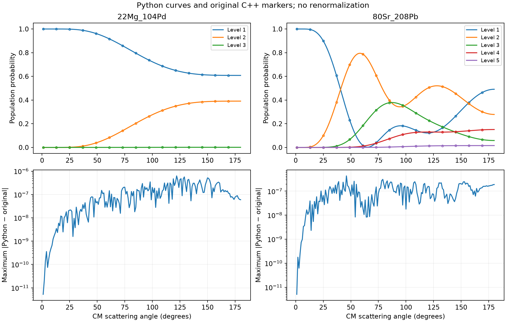

# Numerical validation

Historical comparison, executed before the C++ source and build tools were removed. These saved results are retained as regression data.

Comparison with [TCLX](https://github.com/jhenderson88/TCLX), using `polarization_convention="reference"` to match its model settings. The app uses the literature mass convention (`standard`); its polarized results differ.

Executed 180 angles for each supplied example (2520 level/angle comparisons).

Original agreement: **PASS**. Convergence: **PASS**.

Maximum absolute population difference: **6.26217e-07**.

Acceptance against the historical integrator: `abs(P_python − P_cpp) ≤ 1e-6 + 2e-5*abs(P_cpp)`. This is a regression threshold, not an estimate of physical uncertainty.

| Example | Max probability difference | Max norm drift | Max cross-section difference (b/sr) |
|---|---:|---:|---:|
| 22Mg_104Pd_example | 6.26217e-07 | 3.75144e-13 | 0.000117045 |
| 80Sr_208Pb_example | 4.3173e-07 | 7.68785e-12 | 0.000621812 |

## Independent numerical checks

| Example / angle | Tighter ODE | Longer orbit | RK45 vs DOP853 |
|---|---:|---:|---:|
| 22Mg_104Pd_example / 30° | 1.374e-12 | 6.219e-12 | 7.849e-14 |
| 22Mg_104Pd_example / 90° | 4.945e-12 | 3.641e-11 | 7.336e-11 |
| 22Mg_104Pd_example / 150° | 2.83e-11 | 3.863e-10 | 2.369e-10 |
| 80Sr_208Pb_example / 30° | 1.046e-11 | 1.362e-10 | 9.478e-12 |
| 80Sr_208Pb_example / 90° | 1.904e-10 | 9.138e-10 | 8.593e-10 |
| 80Sr_208Pb_example / 150° | 5.245e-10 | 2.716e-09 | 5.668e-10 |

Each entry is a maximum absolute population change across all levels. Target: <1e-7. This does not certify relative accuracy for extremely small populations.

## What was executed

The comparison runs the unchanged numerical source with a tested minimal ROOT adapter, rather than a full ROOT/GSL installation. It covers E2 projectile excitation from J=0. Other multipoles are checked independently against published theory.

The CSV files contain every comparison, including tiny populations and unnormalized norm diagnostics. The JSON manifest records input hashes, source hashes, compiler, dependency versions and solver settings.
